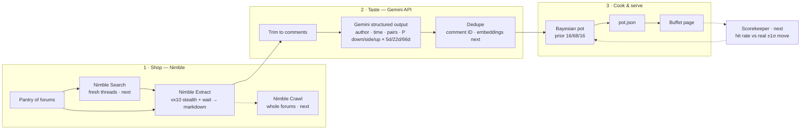

<p align="center">
  
  &nbsp;&nbsp;+&nbsp;&nbsp;
  
</p>

# MalalphAI

**Turning talk into direction.**

Live demo: **https://zhanghaoquan.github.io/malalphai/**

MalalphAI (Mala Alpha AI) turns FX forum chatter into odds on where the US dollar is heading. **Nimble** brings in live forum threads, **Gemini** reads every comment, and a small Bayesian "pot" works out the probability that USD goes **up, down or sideways** against EUR, JPY, GBP and CAD over **5, 22 and 66 days**.

Like a mala hot pot, you season it yourself. Every author is a chef with a track record. Trust the chefs who've been right, turn down the ones who haven't, and even trust someone's bullish calls more than their bearish ones.

## Why

Great ideas come from great data. Every day, thousands of traders post their views on forums like ForexFactory. That's a huge, free, real-time sentiment signal, but it's buried under jokes, politics and reposts, and nobody keeps score of who was right. MalalphAI collects it, cleans it, scores it, and remembers.

## What it does

1. **Shop** (Nimble): you add forums to your pantry. Nimble fetches the threads past bot protection and returns clean markdown with every author, timestamp and permalink.
2. **Taste** (Gemini): Gemini reads each comment and returns structured JSON: who said it, when, which pairs it covers, and the probability of down / sideways / up for each horizon. Jokes and politics are skipped, each with a reason.
3. **Cook** (Bayes): starting from a 16 / 68 / 16 prior (a normal curve split at ±1σ), each opinion shifts the odds. The shift is weighted by the chef's hit rate × your trust × how fresh the comment is.
4. **Serve**: the buffet page shows the pot for 4 pairs × 3 horizons, every opinion behind it, and a full trace and lineage for each one, all the way back to the source comment.

## Real run (11 Oct 2026)

| Step | Result |
| --- | --- |
| Nimble Extract, `vx10` stealth browser | ForexFactory (Cloudflare-protected) fetched in 5.6s for a thread and 9.8s for the news page, giving 70K chars of markdown |
| Comments parsed from Nimble's markdown | 18, each with author, time and comment ID |
| Gemini (`gemini-3.8-flash`, JSON schema) | 2 dollar calls kept, the rest skipped with reasons. 6.1K tokens in, 0.9K out |
| Dedupe by comment ID | Same 2 comments found on both pages, so 4 readings became 1 dish |
| Pot | 4 pairs × 3 horizons updated |

Example: **eqshack** wrote *"Sell usd … Oil down - inflation down - no rate hike - dollar down - stocks up."* Gemini read it as USD-bearish on all four pairs.

## How the kitchen works



**Update rule:** `log P(k) = log prior(k) + Σ wᵢ · log(qᵢ(k) / prior(k))`, where `wᵢ = chef weight × trust(up|down) × 0.5^(age / half-life)`. The half-lives are 2, 7 and 20 days for the 5d, 22d and 66d horizons. A chef's weight starts from a Beta(2,2) prior on their hit rate.

**Pair convention:** USDJPY = yen per dollar (≈158). "Up" always means the USD strengthens.

## Why Nimble

- **Gets past bot walls:** the `vx10` stealth browser fetched Cloudflare-protected ForexFactory on the first try.
- **LLM-ready:** pages come back as markdown with authors, times and permalinks intact.
- **One API for the whole shop:** Search to find threads, Extract to fetch them, Crawl to scale to whole forums.
- **Geo-targeting:** `country` and `locale` read Tokyo, London and Toronto forums the way local traders see them.
- **Cheap:** about $1 per 1,000 pages, so you can re-shop several times a day.

## Why Gemini

- **Structured output:** with `responseSchema`, every opinion arrives with the same fields and needs no parsing.
- **Judgment:** it tells a currency call from a joke or a political aside, and explains every skip.
- **FX sense:** "Sell usd" becomes USD-down on all four pairs, and "EUR/USD up" becomes USDEUR down.
- **Calibrated:** it starts from the baseline and moves only as far as the text justifies.

## Run it

```bash
cp .env.example .env   # add NIMBLE_API_KEY and GEMINI_API_KEY
# 1. Fetch a thread with Nimble
curl -s -X POST https://sdk.nimbleway.com/v2/extract \
  -H "Authorization: Bearer $NIMBLE_API_KEY" -H 'Content-Type: application/json' \
  -d '{"url":"https://www.forexfactory.com/news/1430919-trump-effective-immediately-there-is-an-energy-ceasefire","driver":"vx10","formats":["markdown"],"browser_actions":[{"wait":3000}]}' \
  > data/raw/ff_story_1430919.json
# 2. Read it with Gemini
python3 pipeline/gemini_extract.py data/raw/ff_story_1430919.json > data/extracted/ff_story_1430919.json
# 3. Rebuild the page
python3 pipeline/build_live.py   # writes docs/index.html
```

## Repo

- `pipeline/gemini_extract.py`: Nimble markdown → Gemini structured opinions, with retries, model fallback and a trace (latency, tokens, response ID, source hash).
- `pipeline/build_live.py`: parses the thread, joins it with Gemini's output, dedupes, and builds the page.
- `data/raw/`: saved Nimble responses. `data/extracted/`: saved Gemini output.
- `docs/index.html`: the demo page (GitHub Pages).

## What's next

Nimble Search and Crawl on a schedule, more forums (Reddit, BabyPips, local-language boards via geo-targeting), Gemini embeddings to match reposts across sites, and the scorekeeper that grades each chef once their horizon passes.

---

Built at **AI Engineer NYC 2026** (MLH). Forum quotes come from public ForexFactory threads. This is not trading advice.
