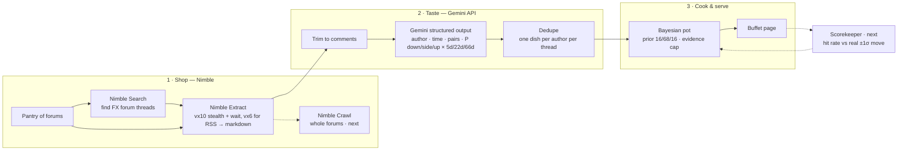

<p align="center">
  
  &nbsp;&nbsp;+&nbsp;&nbsp;
  
</p>

# MalalphAI

**Turning talk into direction.**

Live demo: **https://zhanghaoquan.github.io/malalphai/**

MalalphAI (Mala Alpha AI) turns FX forum chatter into odds on where the US dollar is heading. **Nimble** brings in live forum threads, **Gemini** reads every comment, and a small Bayesian "pot" works out the probability that USD goes **up, down or sideways** against EUR, JPY, GBP and CAD over **5, 22 and 66 days**.

Like a mala hot pot, you season it yourself. Every author is a chef with a track record. Trust the chefs who've been right, turn down the ones who haven't, and even trust someone's bullish calls more than their bearish ones.

## Why

Great ideas come from great data. Every day, thousands of traders post their views on forums like ForexFactory. That's a huge, free, real-time sentiment signal, but it's buried under jokes, politics and reposts, and nobody keeps score of who was right. MalalphAI collects it, cleans it, scores it, and remembers.

## What it does

1. **Shop** (Nimble): you add forums to your pantry. Nimble fetches the threads past bot protection and returns clean markdown with every author, timestamp and permalink.
2. **Taste** (Gemini): Gemini reads each comment and returns structured JSON: who said it, when, which pairs it covers, and the probability of down / sideways / up for each horizon. Jokes and politics are skipped, each with a reason.
3. **Cook** (Bayes): starting from a 16 / 68 / 16 prior (a normal curve split at ±1σ), each opinion shifts the odds. The shift is weighted by the chef's hit rate × your trust × how fresh the comment is.
4. **Serve**: the buffet page shows the pot for 4 pairs × 3 horizons, every opinion behind it, and a full trace and lineage for each one, all the way back to the source comment.

## Real run (11 Oct 2026)

| Step | Result |
| --- | --- |
| **Nimble Search** (`include_domains: forexfactory.com`) | 4 searches found the long-running USD/JPY, USD/CAD, EUR/USD and GBP/USD trading threads |
| **Nimble Extract** (`vx10` stealth browser, 3s wait) | 37 pages from Cloudflare-protected ForexFactory (news, story threads, forums) plus r/Forex's official RSS feeds (`vx6`). 519K chars of markdown, every page HTTP 200, median 5.7s per page, run in parallel |
| Comments parsed from Nimble's markdown | 235, each with author, time and permalink ID |
| **Gemini** (`responseSchema`, Flash, falling back to Flash-Lite on 429/503) | 36 currency calls kept, every skip explained. 148K tokens in, 16K out, median 3.7s per thread |
| Dedupe | Repeats merge into one dish per author per thread: 36 calls became 28 dishes |
| Pot | 4 pairs × 3 horizons, with every number traceable to its source comment |

Example: **eqshack** on ForexFactory wrote *"Sell usd … Oil down - inflation down - no rate hike - dollar down - stocks up."* Gemini read it as USD-bearish on all four pairs: *"Expects lower oil and inflation to prevent rate hikes and push the dollar down."*

## How the kitchen works



**Update rule:** `log P(k) = log prior(k) + Σ wᵢ · log(qᵢ(k) / prior(k))`, where `wᵢ = chef weight × trust(up|down) × 0.5^(age / half-life)`. The half-lives are 2, 7 and 20 days for the 5d, 22d and 66d horizons. A chef's weight starts from a Beta(2,2) prior on their hit rate.

Forum posts echo each other, so each pot's weights are scaled so they never add up to more than 3 independent voices, and no single post counts as more than one. That keeps a pile-on from looking like certainty.

**Pair convention:** USDJPY = yen per dollar (≈158). "Up" always means the USD strengthens.

## Why Nimble

- **Gets past bot walls:** the `vx10` stealth browser fetched Cloudflare-protected ForexFactory on the first try.
- **LLM-ready:** pages come back as markdown with authors, times and permalinks intact.
- **One API for the whole shop:** Search to find threads, Extract to fetch them, Crawl to scale to whole forums.
- **Geo-targeting:** `country` and `locale` read Tokyo, London and Toronto forums the way local traders see them.
- **Cheap:** about $1 per 1,000 pages, so you can re-shop several times a day.

## Why Gemini

- **Structured output:** with `responseSchema`, every opinion arrives with the same fields and needs no parsing.
- **Judgment:** it tells a currency call from a joke or a political aside, and explains every skip.
- **FX sense:** "Sell usd" becomes USD-down on all four pairs, and "EUR/USD up" becomes USDEUR down.
- **Calibrated:** it starts from the baseline and moves only as far as the text justifies.

## Run it

```bash
cp .env.example .env              # add NIMBLE_API_KEY and GEMINI_API_KEY
python3 pipeline/shop.py 30       # Nimble: FF news page + every FX story / commented thread, then Gemini
python3 pipeline/reddit.py        # Nimble: r/Forex official RSS feeds, then Gemini
python3 pipeline/taste_queue.py   # Gemini: read anything not yet read, gently (rate limits)
python3 pipeline/build_live.py    # build docs/index.html
python3 video/render.py           # optional: product screenshots + long comic cut
python3 video/render60.py         # optional: 60s cut narrated with Gemini text-to-speech
```

## Repo

- `pipeline/shop.py`, `pipeline/reddit.py`: Nimble shopping (Extract, with the stealth `vx10` or fast `vx6` driver).
- `pipeline/gemini_extract.py`: Nimble markdown → Gemini structured opinions, with retries, model fallback and a trace (latency, tokens, response ID, source hash).
- `data/search/`: Nimble Search results used to find the forum threads.
- `pipeline/build_live.py`: parses the thread, joins it with Gemini's output, dedupes, and builds the page.
- `data/raw/`: saved Nimble responses. `data/extracted/`: saved Gemini output.
- `docs/index.html`: the demo page (GitHub Pages). `mockup/index.html` is its source.
- `video/`: the comic demo video. Panels are HTML (`comic.html`), and the narration is Gemini TTS (`gemini-3.8-flash-tts`).

## From demo to always-on

**Today:** a batch pipeline we ran live during the hackathon. Results are JSON in git and the page is static HTML on GitHub Pages. The "Add" box on the page doesn't do anything yet. Reading a new site is already mostly generic: Nimble returns markdown for any site, and Gemini extracts calls from any markdown. Only the Thread receipt view uses site-specific parsers, and every other site falls back to Gemini's own record of who said what.

**Making it continuous (a few hours, no new infrastructure):**
1. **Schedule:** a GitHub Actions cron (for example hourly) runs shop → read → build → commit `docs/`. Keys go in Actions secrets.
2. **Add sites on the fly:** a `sources.yaml` list of URLs and Nimble settings. The page's "Add" opens a prefilled pull request, or calls a small serverless endpoint. Nimble Map/Crawl discovers threads on the new site, and Extract → Gemini works unchanged.
3. **Idempotent runs:** opinions are keyed by site + comment ID and updated in place, so re-shopping never double-counts.
4. **Cost:** about 50 pages an hour is roughly $1.20 a day of Nimble at listed prices. Gemini runs through the existing queue with backoff and a Flash → Flash-Lite fallback.

**Making it real:**
5. **Scorekeeper:** fetch daily FX closes and σ per horizon, then grade each call (up, down, or inside ±1σ) once its 5, 22 or 66 days pass. Hit rates then become author weights.
6. **Storage:** a time-series Postgres such as Tiger Data for opinions, prices and pot snapshots, with rolling aggregates per pair and per author. Snowflake (Cortex + Streamlit) fits if a bank wants this inside its own warehouse.
7. **More stalls:** BabyPips and local-language forums via Nimble geo-targeting, and Gemini embeddings to match the same view reposted across sites.

The hard parts, getting past bot walls and telling a real call from noise, are what Nimble and Gemini already do in the demo.

---

Built at **AI Engineer NYC 2026** (MLH). Forum quotes come from public ForexFactory threads and the official r/Forex RSS feed. This is not trading advice.
